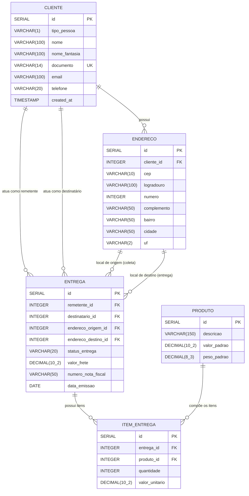

# Sistema de Entregas 

Um sistema simples de logística via terminal (CLI) construído em Java. O projeto foi desenvolvido para praticar conceitos fundamentais de Orientação a Objetos (POO), encapsulamento e organização de código.

## O que o sistema faz
- **Cadastro de Clientes:** Salva dados do cliente e seu endereço.
- **Cadastro de Produtos:** Registra itens com peso e valor.
- **Gestão de Entregas:** Junta o cliente aos produtos escolhidos e calcula o frete.
- **Relatórios:** Exibe um resumo completo de todas as entregas e pacotes registrados.

## Tecnologias e Estrutura
- **Linguagem:** Java
- **Armazenamento:** `ArrayList` (dados salvos na memória durante a execução).
- **Organização de Pacotes:** 
  - `models/`: Classes de molde (`Cliente`, `Produto`, etc).
  - `service/`: Onde a mágica acontece (`Sistema` com a lógica e menus).
  - `app/`: Apenas o `Main` para iniciar o programa.

